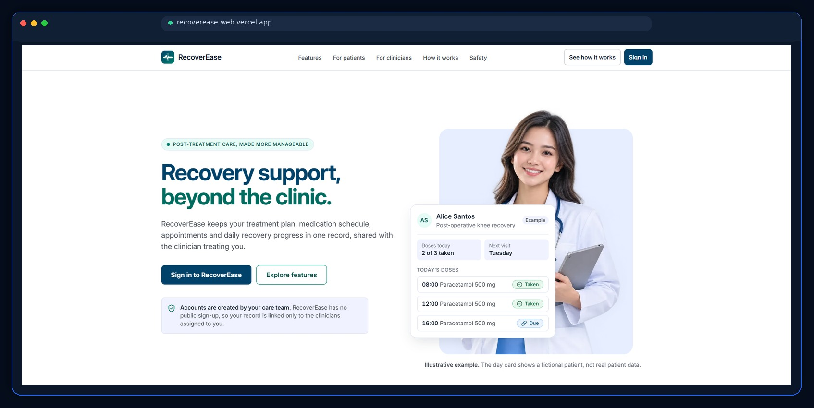
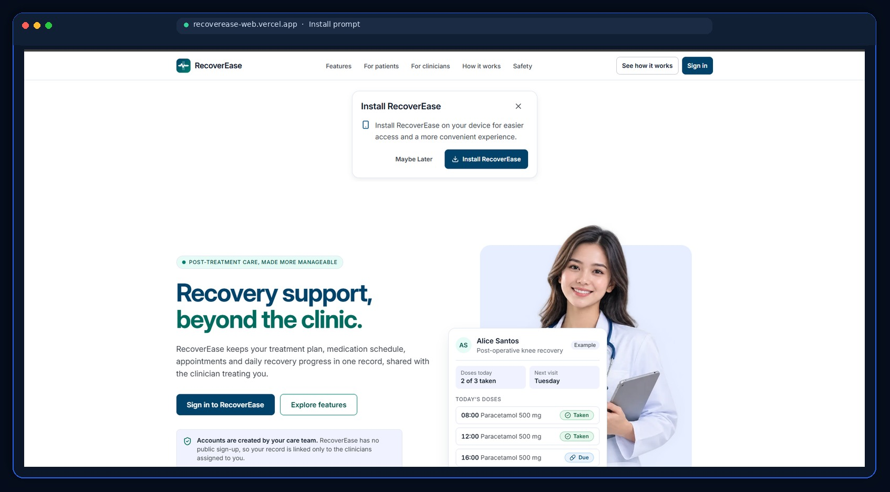
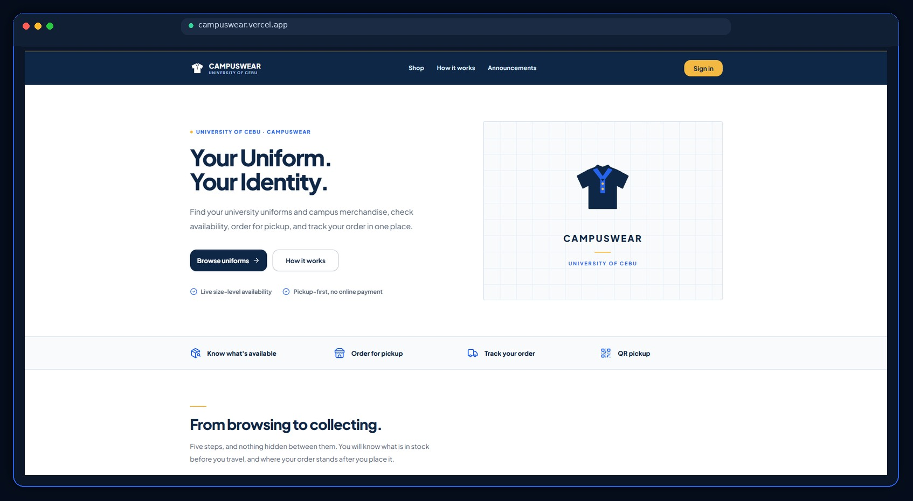
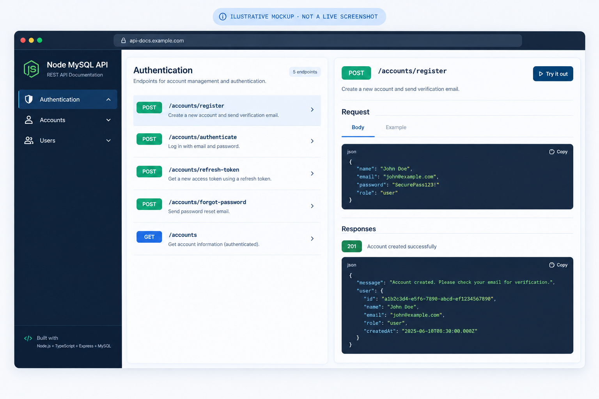
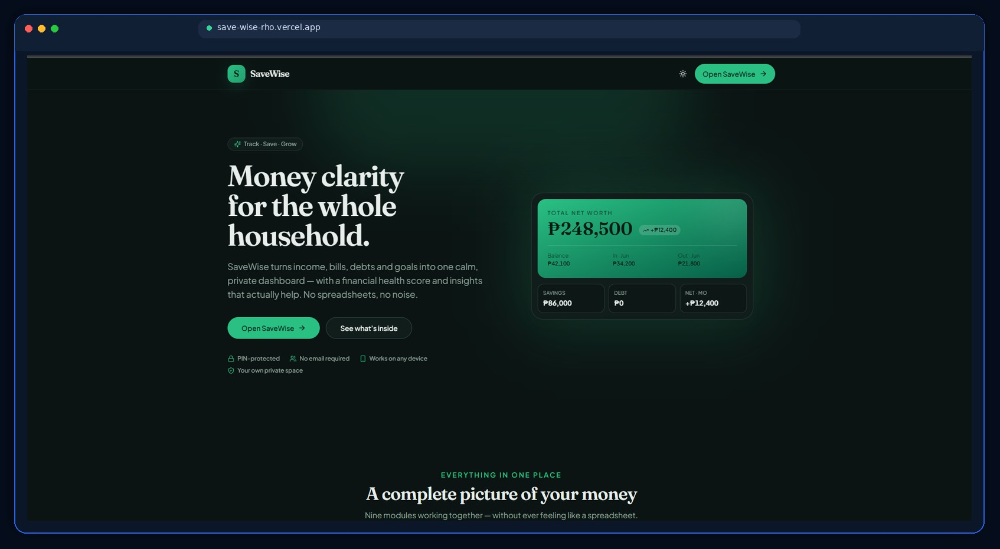

 

**Building practical software. Learning by building. Improving through every iteration.**

---

## About Me

I'm a Bachelor of Science in Information Technology (BSIT) student focused on full-stack development, system analysis, and database-driven applications.

I learn by building practical projects, understanding how their components work together, troubleshooting problems, and testing changes. My goal is to become a dependable software developer who can build useful systems and explain the technical decisions behind them.

- **Development:** Frontend applications, backend APIs, and database systems.
- **Problem-solving:** Requirements analysis, debugging, and implementation.
- **Engineering practices:** Testing, access control, documentation, and maintainability.
- **Continuous learning:** Hands-on practice and AI-assisted learning with personal code review and verification.

## Featured Projects

<table>
<tr>
<td width="50%" valign="top">

### RecoverEase

**Post-treatment care management · Capstone project**

A healthcare recovery platform connecting patients, doctors, and administrators through organized recovery workflows.

**Key areas**
- Treatment plans and recovery progress monitoring
- Medication tracking and appointment management
- Notifications, reminders, and announcements
- AI-assisted recovery guidance

**Stack:** React · TypeScript · Supabase · PostgreSQL · Gemini · Vercel

**My role:** Lead programmer and system analyst on the capstone team.

[**Source code**](https://github.com/recovereasedev/RecoverEase) · [**Live application**](https://recoverease-web.vercel.app)

View additional RecoverEase screenshot

 

</td>
<td width="50%" valign="top">

### CampusWear

**University uniform ordering · MVP**

A student-built MVP exploring an online uniform ordering and inventory workflow for students and vendors.

**Key areas**
- Product catalog and size-level inventory
- Pickup ordering and order tracking
- QR-based pickup verification
- Vendor product and order management

**Stack:** React · TypeScript · Vite · Tailwind CSS · Supabase · PostgreSQL

[**Source code**](https://github.com/KeanCaballero/CampusWear) · [**Live application**](https://campuswear.vercel.app)

</td>
</tr>
<tr>
<td width="50%" valign="top">

### Node MySQL API

**REST API · Backend development**

A backend project demonstrating account-management endpoints and authentication workflows.

> **Image note:** This is a generated illustrative mockup, not a screenshot from the live API. Replace it with a real capture of the Swagger UI when available.

**Key areas**
- Registration and email verification
- JWT authentication and refresh tokens
- Password reset and account endpoints
- Swagger API documentation

**Stack:** Node.js · TypeScript · Express · MySQL/MariaDB · Sequelize

[**Source code**](https://github.com/KeanCaballero/node-mysql-api) · [**API documentation**](https://ipt-2026-backend.vercel.app/api-docs)

</td>
<td width="50%" valign="top">

### SaveWise

**Personal finance · Prototype**

A personal finance application for organizing transactions, budgets, savings goals, bills, loans, and subscriptions.

**Key areas**
- Transaction and budget management
- Savings goals and financial summaries
- Bills, loans, and subscription tracking
- Demo mode and Supabase integration

**Stack:** React · JavaScript · Vite · Tailwind CSS · Supabase · PostgreSQL

This remains a prototype. Its multi-user access controls need further hardening before it should be used with real financial information.

[**Source code**](https://github.com/KeanCaballero/SaveWise) · [**Live demo**](https://save-wise-rho.vercel.app)

</td>
</tr>
</table>

## Technology Stack

**Frontend**

**Backend and databases**

**Tools and embedded systems**

## How I Approach Development

I use AI coding assistants such as ChatGPT and Claude to help me learn unfamiliar concepts, explore possible approaches, and troubleshoot problems. I still need to understand the code I use, review suggestions, make implementation decisions, and verify changes through testing.

My development loop is simple:

**Understand → Implement → Review → Debug → Test → Improve**

My goal is to keep becoming more independent at diagnosing problems and explaining why a solution works.

## Areas of Focus

| Area | Focus |
|:--|:--|
| **Frontend** | Responsive interfaces and reusable components |
| **Backend** | REST APIs and application logic |
| **Databases** | Data modeling, SQL, and access control |
| **Security** | Authentication and authorization |
| **Quality** | Testing, debugging, and maintainability |
| **System analysis** | Requirements, workflows, and technical documentation |

## GitHub Overview

 

---

**Thanks for visiting my profile.**

*Learning continuously. Building practically. Improving every day.*

